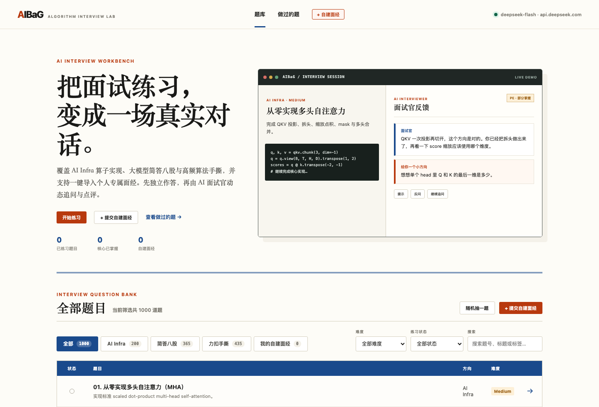
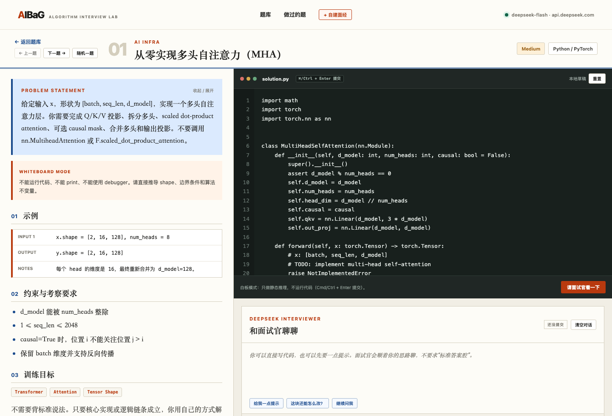
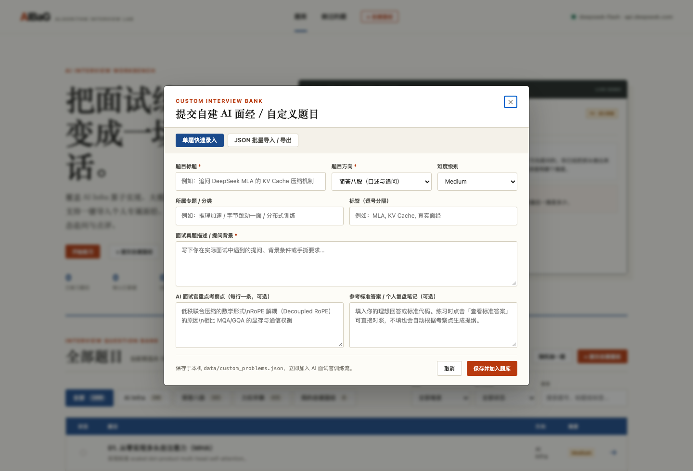

# AIBaG · 本地优先的 AI 面试与算法训练场

**简体中文** | [English](README_EN.md)

**AIBaG (Algorithm & AI Interview Lab)** 是一个零第三方依赖、本地优先的 AI 面试与算法训练工作台。内置 **1,000 道** AI Infra 算子实现、大模型简答八股与高频算法手撕题，并支持一键录入或批量导入个人专属面经（`自建面经`）。

不同于传统刷题网站只看“测试用例是否通过”或死记硬背标准八股文，AIBaG 模拟真实技术面试的白板推导与口述追问环节：先独立作答，再由 AI 面试官进行结构化诊断（Pass / Partial / Retry）、亮点提取与渐进式多轮追问。

---

## 界面预览

### 1. 题库首页与多维筛选
> 直观展示各分类题量、个人练习统计，支持按方向、难度、练习状态筛选与随机抽题。



### 2. 白板推导与口述面试工作台
> 左侧阅读题面、约束与即时参考答案；右侧白板编码/口述作答（支持 `⌘/Ctrl + Enter` 快捷提交），AI 面试官生成结构化评估卡片并支持多轮互动追问。



### 3. 自建 AI 面经与 JSON 批量导入/导出
> 随时将真实面试中遇到的追问或手撕题录入本地题库，自动接入 AI 面试官评估闭环。



---

## 核心特性

1. **三大核心赛道 + 1,000 道结构化题库**
   - **AI Infra (`200` 题)**：覆盖 Multi-Head Attention、FlashAttention 分块 Online Softmax、RoPE、KV Cache 量化、Ring AllReduce 等核心算子与系统实现。
   - **简答八股 (`365` 题)**：覆盖大模型架构、分布式训练（ZeRO / TP / PP / EP）、推理加速与机器学习基础，内置 **PE (Proficiency Evaluation)** 掌握度评估状态机，拒绝死记硬背。
   - **力扣手撕 (`435` 题)**：高频数据结构与算法白板推导，重点训练复杂度分析、循环不变量与边界条件。

2. **自建面经闭环 (`Custom Interview Bank`)**
   - **单题快速录入**：在页面顶部或题库右上角点击「`+ 提交自建面经`」，即可填写标题、题型、题面描述、考察要点与个人复盘答案。
   - **JSON 批量导入 / 导出**：支持粘贴 JSON 数组、上传本地 `.json` 文件或一键导出自建题库备份。
   - **隐私安全**：自建题目持久化保存在本机 `data/custom_problems.json`（默认加入 `.gitignore`，不会意外上传至公共仓库）。

3. **高可用交互体验**
   - **全键盘流与无缝切题**：作答页顶部内置 `← 上一题`、`下一题 →`（支持 `Alt + ←/→`）与 `随机一题`；编辑器支持 `⌘/Ctrl + Enter` 一键提交。
   - **结构化面试官诊断卡片**：每次提交后直观展示得分、核心亮点（Strengths）、当前待补全盲区（Focus Issue）与下一步追问。
   - **零延迟标准答案与一键复制**：所有内置题均配备持久化标准答案，点击立即展开且无需等待模型生成，支持一键复制代码/解析。
   - **本地练习档案管理**：在「做过的题」页面查看已练习题数、核心掌握数与平均得分，支持多维过滤与练习记录 JSON 导出备份。

---

## 快速开始

项目仅依赖 **Python 3 标准库**，无需安装任何第三方 `pip` 或 `npm` 包。

### 1. 配置模型 API Key

首次使用时复制环境变量模板：

```bash
cp .env.example .env
```

编辑 `.env` 并填入兼容 OpenAI Chat Completions 接口的 API Key（默认支持 DeepSeek）：

```ini
AIBAG_API_KEY=your_api_key_here
AIBAG_BASE_URL=https://api.deepseek.com
AIBAG_MODEL=deepseek-chat
AIBAG_PORT=8787
```

> **安全说明**：API Key 仅由本地后端从 `.env` 或私有凭据文件读取，绝不会通过前端接口暴露，也不会被 Git 跟踪。

### 2. 一键启动服务

```bash
./start.sh
```

脚本会自动启动本地服务并打开浏览器访问 <http://127.0.0.1:8787>。你也可以直接运行：

```bash
python3 server.py
```

---

## 自建面经 JSON 格式说明

当使用「JSON 批量导入」功能时，可传入题目数组 `[...]` 或 `{"problems": [...]}`，单次最多支持导入 200 道题。示例格式如下：

```json
[
  {
    "title": "DeepSeek MLA 相比 GQA 如何进一步压缩 KV Cache？",
    "kind": "knowledge",
    "difficulty": "Hard",
    "category": "大模型推理面经",
    "tags": ["MLA", "KV Cache", "DeepSeek"],
    "description": "请结合低秩联合压缩机制与 Decoupled RoPE 设计，讲清 MLA 为什么能大幅降低 KV Cache。",
    "review_points": [
      "低秩潜在向量压缩与投影矩阵吸收",
      "为什么 RoPE 需要解耦（Decoupled RoPE）",
      "推理阶段显存与算力权衡"
    ],
    "answer": "MLA 将 KV 联合投影到低维潜在向量，推理时仅缓存潜在向量，并通过矩阵乘法结合律将解压矩阵吸收进 W^Q 与 W^O..."
  }
]
```

字段说明：
- `title` *(必填)*：题目标题。
- `description` *(必填)*：面试提问背景、题目描述或手撕要求。
- `kind` *(选填)*：支持 `"knowledge"`（简答八股）、`"coding"`（AI Infra）、`"algorithm"`（力扣手撕），默认 `"knowledge"`。
- `difficulty` *(选填)*：`"Easy"` | `"Medium"` | `"Hard"`，默认 `"Medium"`。
- `starter_code` *(选填)*：代码题初始模板。
- `review_points` *(选填)*：AI 面试官重点考察的评分要点列表；不填时系统会根据题型自动生成默认考察维度。
- `answer` *(选填)*：参考标准答案或个人复盘笔记。

---

## 项目结构与数据来源

```text
AIBaG/
├── server.py                  # 本地 Web 服务、自建题库管理与大模型 API 代理
├── index.html / app.js        # 题库首页、多维筛选与自建面经弹窗逻辑
├── problem.html / problem.js  # 白板编码/口述工作台与 AI 面试官多轮对话
├── completed.html / .js       # 本机练习档案、统计看板与记录导出
├── style.css                  # 全局排版与响应式样式
├── prompts/                   # AI 面试官评审 (judge) 与追问 (coach / PE) 提示词
├── data/
│   ├── catalog/               # 200 道基础标准题分片数据
│   ├── variant_templates.json # 4 组面试训练视角模板（运行时组合为 1,000 道题）
│   ├── answers.json           # 持久化标准答案库（即时展示，零模型调用开销）
│   └── custom_problems.json   # 用户本机自建面经数据（自动生成，Git 忽略）
└── tests/test_server.py       # 题库完整性、启动性能、AI 评审与自建题库单元测试
```

### 致谢与开源许可

- 内置题库中包含 200 道基础题与 4 组结构化训练变体（共 1,000 道练习题）。
- 部分大模型八股与算法题目改编自 MIT 许可的开源项目 [axiaoquan/llm-interview-handbook](https://github.com/axiaoquan/llm-interview-handbook)（上游 commit `8a86e722dcdb77de472daefa9401a859deb96f63`）。
- 完整版权声明与第三方许可请参见 [`THIRD_PARTY_NOTICES.md`](THIRD_PARTY_NOTICES.md) 与 [`third_party/llm-interview-handbook-LICENSE`](third_party/llm-interview-handbook-LICENSE)。

---

## 运行单元测试

```bash
python3 -m unittest discover -s tests -v
```
